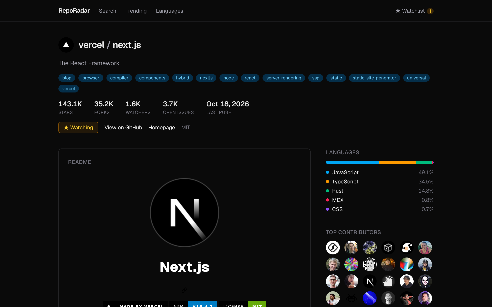
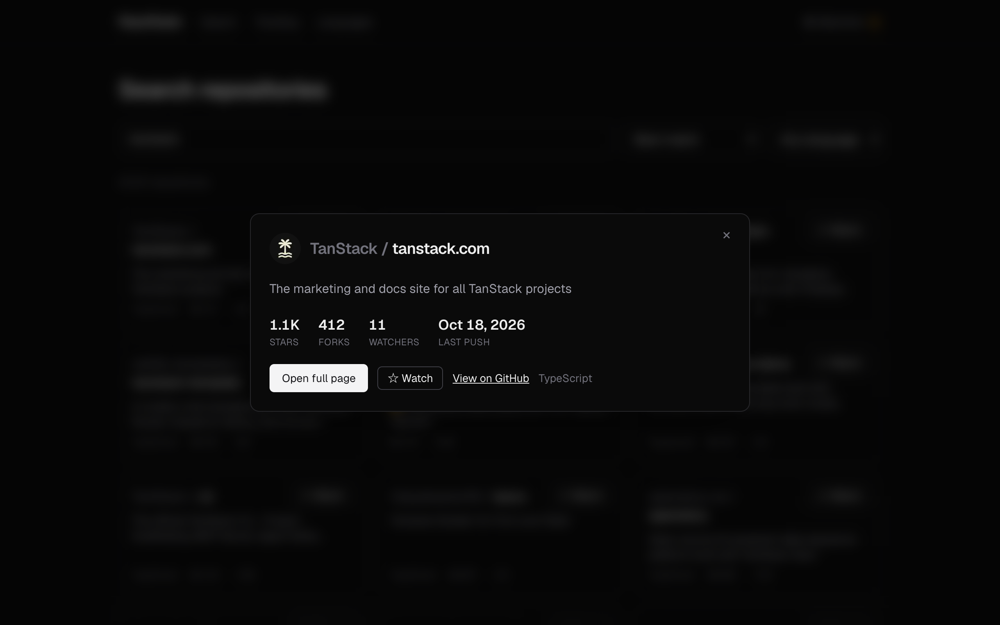
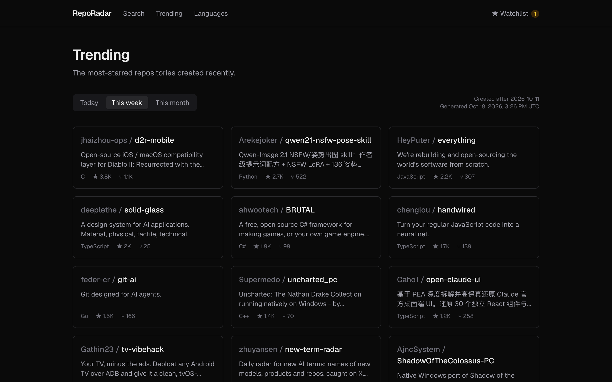

# RepoRadar

[](https://github.com/tarnishedMind/RepoRadar/actions/workflows/ci.yml)

Explore GitHub repositories, developers and what's trending, powered by the public GitHub API.

A portfolio project built to show the modern Next.js App Router end to end: Server
Components, streaming, ISR with on-demand revalidation, parallel and intercepting routes,
Server Actions, Proxy, generated Open Graph images, and TanStack Query v5 layered on top
for infinite scroll, hover prefetching, server-to-client cache hydration and optimistic
updates.



| Search with an intercepted preview modal | Trending (ISR) |
| --- | --- |
|  |  |

## What's inside

| Feature | Next.js / React concepts |
| --- | --- |
| Repo and user pages (`/vercel/next.js`, `/u/torvalds`) | Server Components, Partial Prerendering, `<Suspense>` streaming per section, `generateMetadata`, `loading` / `error` / `not-found` files |
| Trending and language leaderboards | ISR with `"use cache"`, `cacheLife`, `cacheTag`, `generateStaticParams`, optional catch-all route |
| `POST /api/revalidate` | Route Handler + `revalidateTag` for on-demand revalidation |
| Search (`/search?q=…`) | Server prefetch + `HydrationBoundary`, `useInfiniteQuery` infinite scroll, URL-synced filters, hover prefetch |
| Repo preview modal | Parallel route slot (`@modal`) + intercepting route (`(..)[owner]/[repo]`) |
| Watchlist (`/watchlist`) | Server Actions, cookies, optimistic updates with TanStack `onMutate` and React `useOptimistic` |
| GitHub-style URLs (`/vercel/next.js.git`, `/@torvalds`) | `proxy.ts` redirects, rewrites and headers |
| Link previews, SEO | `opengraph-image.tsx` (generated with `next/og`), `sitemap.ts`, `robots.ts` |

## Project structure

```
src/
  app/        routing only (pages, layouts, Route Handlers, metadata files)
  features/   repo · search · watchlist · trending · leaderboard · user
  entities/   github: API client, cached reads, cache tags, types, catalogs
  shared/     ui · lib · hooks · config, with no domain knowledge
  proxy.ts
```

Layers only import downward (`app → features → entities → shared`), and each feature is
used only through its `index.ts` (client-safe) or `server.ts` (server-only). ESLint
enforces both. The decisions behind this are in [docs/adr/](docs/adr/README.md).

The full walkthrough, written for developers coming from single-page apps and with
diagrams for every flow, is in **[docs/ARCHITECTURE.md](docs/ARCHITECTURE.md)**. The
milestone plan is in [docs/PLAN.md](docs/PLAN.md).

## Stack

Next.js 16 · React 19 · TypeScript · Tailwind CSS v4 · TanStack Query v5 · Vitest ·
Playwright · pnpm · Node 22 · Vercel

## Getting started

```bash
nvm use                       # Node 22 (see .nvmrc)
pnpm install
cp .env.example .env.local    # add a GITHUB_TOKEN (recommended)
pnpm dev
```

Open http://localhost:3000.

### Environment variables

| Variable | Required | Purpose |
| --- | --- | --- |
| `GITHUB_TOKEN` | Recommended | Raises the GitHub API limit from 60 to 5,000 requests an hour. A fine-grained token with "Public repositories" access and no permissions is enough. |
| `REVALIDATE_SECRET` | For `/api/revalidate` | Shared secret for on-demand revalidation. Any random string (`openssl rand -hex 32`). |
| `NEXT_PUBLIC_SITE_URL` | No | Absolute base URL for OG tags, sitemap and robots. On Vercel the production domain is used automatically. |

## Scripts

| Command | Description |
| --- | --- |
| `pnpm dev` | Dev server (Turbopack) |
| `pnpm build` / `pnpm start` | Production build and server. Caching and ISR only behave for real here. |
| `pnpm lint` | ESLint, including the layer and import-boundary rules |
| `pnpm typecheck` | Generate route types, then `tsc` |
| `pnpm test` | Unit tests (Vitest): GitHub client, repo names, search params, query options, trending ranges, watchlist cookie, proxy |
| `pnpm test:e2e` | Smoke tests (Playwright) against a production build. Run `pnpm build` first. Uses your installed Chrome locally. |

## Testing and CI

- **Unit tests** (`src/**/*.test.ts`) run in plain Node with Vitest. `fetch` and
  `next/headers` are mocked, so they never touch GitHub.
- **Smoke tests** (`e2e/`) start `next start` and drive Chrome through the main flows:
  search, the preview modal, watchlist, proxy redirects and the 404 page. They use the
  real GitHub API.
- **GitHub Actions** (`.github/workflows/ci.yml`) runs on every push to `main` and every
  pull request: lint, typecheck and unit tests in one job; build and smoke tests in
  another. The build uses the workflow's built-in `GITHUB_TOKEN`, so no extra secret is
  needed.

## Deploying to Vercel

1. Push the repo to GitHub.
2. On [vercel.com](https://vercel.com), choose **Add New → Project** and import the repo.
   Vercel detects Next.js and pnpm; keep the defaults.
3. Add `GITHUB_TOKEN` and `REVALIDATE_SECRET` under **Settings → Environment Variables**.
4. Deploy. From then on every push to `main` deploys to production and every pull
   request gets a preview URL.
5. Optional: under **Settings → Deployment Checks**, require the CI workflow to pass
   before a deployment is promoted.

## On-demand revalidation

Trending pages regenerate hourly and leaderboards daily. To refresh them immediately,
call the route handler with one or more cache tags:

```bash
curl -X POST https://your-domain/api/revalidate \
  -H "Authorization: Bearer $REVALIDATE_SECRET" \
  -H "Content-Type: application/json" \
  -d '{"tags":["trending","leaderboard:rust","repo:vercel/next.js"]}'
```

Tags: `trending`, `trending:<daily|weekly|monthly>`, `leaderboard`, `leaderboard:<lang>`,
`repo:<owner>/<name>`, `user:<login>`. Stale pages keep being served while the fresh
version regenerates in the background.
